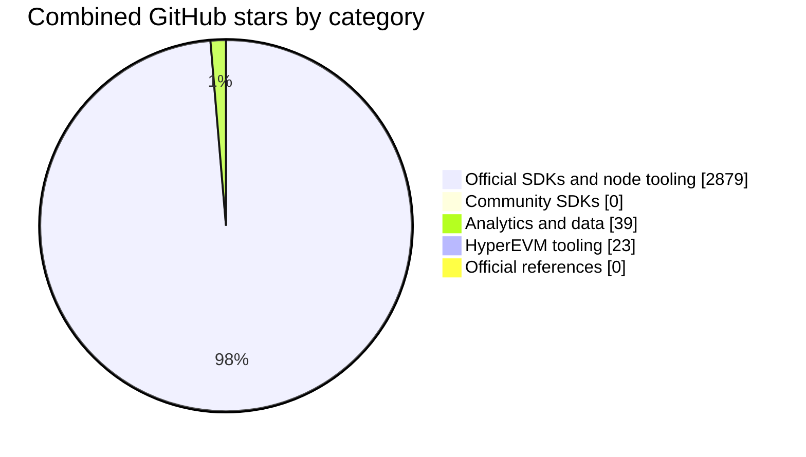

# Awesome Craft Hyperliquid 

> A curated list of verified open-source SDKs, node tools, analytics and community libraries for the Hyperliquid ecosystem.

Automated trading and leverage carry real financial risk. Review bots and SDKs before connecting API wallets or keys. Nothing in this list is investment, trading or yield advice. Community and unaudited tools can lose funds or leak secrets.

Official Hyperliquid documentation is a reference, not an open-source application. Several official repositories publish SDKs or node tooling; the matching engine and full trading stack are not assumed to be fully open source just because an SDK exists. Community SDKs and bots are unofficial unless an official doc names them. Unaudited trading bots can lose funds or leak keys. The Hyperliquid org also publishes some repositories with no SPDX licence on GitHub; those are flagged or omitted until terms are clear.

Related lists: [Awesome Craft](https://github.com/EdisonTKPcom/Awesome-Craft), [Awesome Craft Web3](https://github.com/EdisonTKPcom/Awesome-Craft-Web3), [Awesome Craft Ethereum](https://github.com/EdisonTKPcom/Awesome-Craft-Ethereum).

## Contents

- [Dashboard](#dashboard)
- [Official SDKs and node tooling](#official-sdks-and-node-tooling)
- [Community SDKs](#community-sdks)
- [Analytics and data](#analytics-and-data)
- [HyperEVM tooling](#hyperevm-tooling)
- [Official references](#official-references)

## Dashboard

<table>
<tr>
<td align="center"><h2>8</h2>listed projects</td>
<td align="center"><h2>5</h2>categories</td>
<td align="center"><h2>2.9k</h2>combined GitHub stars</td>
<td align="center"><h2>1.1k</h2>combined forks</td>
<td align="center"><h2>0/6</h2>pushed in the last 30 days</td>
<td align="center"><h2>4</h2>languages</td>
</tr>
</table>

Stats snapshot taken on 2026-11-15 from the GitHub API, for GitHub-hosted repositories only. Official documentation and other non-GitHub entries are listed but have no stars, forks or push dates. Star badges next to GitHub entries update live.

### 🏆 Leaderboard

<table>
<tr><th>Rank</th><th>Project</th><th>Kind</th><th align="right">Stars</th><th></th></tr>
<tr><td align="center">🥇</td><td><b>hyperliquid-python-sdk</b></td><td>Official Python SDK</td><td align="right">1.9k</td><td><code>████████████████████</code></td></tr>
<tr><td align="center">🥈</td><td><b>Hyperliquid node</b></td><td>Node software</td><td align="right">516</td><td><code>█████</code></td></tr>
<tr><td align="center">🥉</td><td><b>hyperliquid-rust-sdk</b></td><td>Official Rust SDK</td><td align="right">475</td><td><code>█████</code></td></tr>
<tr><td align="center">4</td><td><b>hyperliquid-stats-web</b></td><td>Protocol stats UI</td><td align="right">39</td><td><code>█</code></td></tr>
<tr><td align="center">5</td><td><b>hyper-evm-sync</b></td><td>HyperEVM tool</td><td align="right">21</td><td><code>█</code></td></tr>
<tr><td align="center">6</td><td><b>block-importer</b></td><td>HyperEVM tool</td><td align="right">2</td><td><code>█</code></td></tr>
</table>

### Stars by category

### Licences

  

"Custom" or "None" means GitHub could not match a standard SPDX licence, often because of extra terms or an undeclared licence. Read the project licence before you use it commercially.

## Official SDKs and node tooling

- [Hyperliquid node](https://github.com/hyperliquid-dex/node) - Official node software published by the hyperliquid-dex organization. 
- [hyperliquid-python-sdk](https://github.com/hyperliquid-dex/hyperliquid-python-sdk) - The official Python SDK for the Hyperliquid trading API, documented by Hyperliquid. 
- [hyperliquid-rust-sdk](https://github.com/hyperliquid-dex/hyperliquid-rust-sdk) - The official Rust SDK for the Hyperliquid trading API, published by hyperliquid-dex. 

## Community SDKs

- [nktkas/hyperliquid](https://github.com/nktkas/hyperliquid) - A community TypeScript SDK for the Hyperliquid API, written for major JS runtimes. Official Hyperliquid API docs list this among community TypeScript SDKs. It is unofficial; review the code and licence before using it with API wallets or keys. 

## Analytics and data

- [hyperliquid-stats-web](https://github.com/hyperliquid-dex/hyperliquid-stats-web) - An official web UI for exploring Hyperliquid protocol statistics. 

## HyperEVM tooling

- [block-importer](https://github.com/hyperliquid-dex/block-importer) - Official tooling that imports HyperEVM block data into hl-node. GitHub listed no SPDX licence at the research snapshot; confirm terms before use. 
- [hyper-evm-sync](https://github.com/hyperliquid-dex/hyper-evm-sync) - Official HyperEVM sync tooling published by hyperliquid-dex. GitHub listed no SPDX licence at the research snapshot; confirm terms before use. 

## Official references

- [Hyperliquid API docs](https://hyperliquid.gitbook.io/hyperliquid-docs/for-developers/api) - Official Hyperliquid API documentation, including pointers to official and community SDKs. This is a reference, not an installable open-source product.

## Contributing

Contributions welcome! Read the [contribution guidelines](contributing.md) first.

If this list is useful, give it a ⭐ so others can find it.

