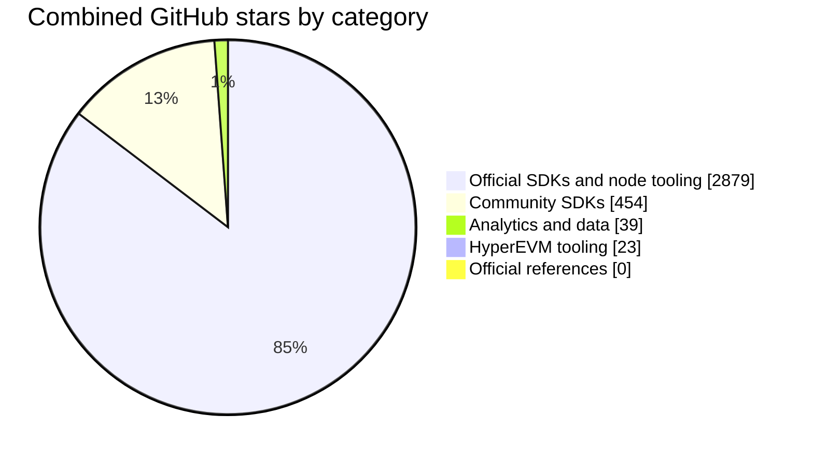

# Awesome Craft Hyperliquid 

> A curated list of verified open-source SDKs, node tools, analytics and community libraries for the Hyperliquid ecosystem.

Automated trading and leverage carry real financial risk. Review bots and SDKs before connecting API wallets or keys. Nothing in this list is investment, trading or yield advice. Community and unaudited tools can lose funds or leak secrets.

Official Hyperliquid documentation is a reference, not an open-source application. Several official repositories publish SDKs or node tooling; the matching engine and full trading stack are not assumed to be fully open source just because an SDK exists. Community SDKs and bots are unofficial unless an official doc names them. Unaudited trading bots can lose funds or leak keys. The Hyperliquid org also publishes some repositories with no SPDX licence on GitHub; those are flagged or omitted until terms are clear.

## Contents

- [Dashboard](#dashboard)
- [Official SDKs and node tooling](#official-sdks-and-node-tooling)
- [Community SDKs](#community-sdks)
- [Analytics and data](#analytics-and-data)
- [HyperEVM tooling](#hyperevm-tooling)
- [Official references](#official-references)
- [Related lists](#related-lists)
- [Star history](#star-history)

## Dashboard

<table>
<tr>
<td align="center"><h2>8</h2>listed projects</td>
<td align="center"><h2>5</h2>categories</td>
<td align="center"><h2>3.4k</h2>combined GitHub stars</td>
<td align="center"><h2>1.2k</h2>combined forks</td>
<td align="center"><h2>0/7</h2>pushed in the last 30 days</td>
<td align="center"><h2>4</h2>languages</td>
</tr>
</table>

**FACT** (snapshot taken 2026-11-15, GitHub API): 8 listed projects, 7 of them on GitHub with public repository statistics. Official documentation and other non-GitHub entries are listed but have no stars, forks or push dates.

**ESTIMATE**: 3.4k combined GitHub stars and 1.2k combined forks, summed from those API counts on the snapshot date. Live star badges next to GitHub entries may differ.

### 🏆 Leaderboard

<table>
<tr><th>Rank</th><th>Project</th><th>Kind</th><th align="right">Stars</th><th></th></tr>
<tr><td align="center">🥇</td><td><b>hyperliquid-python-sdk</b></td><td>Official Python SDK</td><td align="right">1.9k</td><td><code>████████████████████</code></td></tr>
<tr><td align="center">🥈</td><td><b>Hyperliquid node</b></td><td>Node software</td><td align="right">516</td><td><code>█████</code></td></tr>
<tr><td align="center">🥉</td><td><b>hyperliquid-rust-sdk</b></td><td>Official Rust SDK</td><td align="right">475</td><td><code>█████</code></td></tr>
<tr><td align="center">4</td><td><b>nktkas/hyperliquid</b></td><td>Community TypeScript SDK</td><td align="right">454</td><td><code>█████</code></td></tr>
<tr><td align="center">5</td><td><b>hyperliquid-stats-web</b></td><td>Protocol stats UI</td><td align="right">39</td><td><code>█</code></td></tr>
<tr><td align="center">6</td><td><b>hyper-evm-sync</b></td><td>HyperEVM tool</td><td align="right">21</td><td><code>█</code></td></tr>
<tr><td align="center">7</td><td><b>block-importer</b></td><td>HyperEVM tool</td><td align="right">2</td><td><code>█</code></td></tr>
</table>

### Stars by category

### Licences

  

"Custom" or "None" means GitHub could not match a standard SPDX licence, often because of extra terms or an undeclared licence. Read the project licence before you use it commercially.

## Official SDKs and node tooling

- [Hyperliquid node](https://github.com/hyperliquid-dex/node) - Official node software published by the hyperliquid-dex organization. 
- [hyperliquid-python-sdk](https://github.com/hyperliquid-dex/hyperliquid-python-sdk) - The official Python SDK for the Hyperliquid trading API, documented by Hyperliquid. 
- [hyperliquid-rust-sdk](https://github.com/hyperliquid-dex/hyperliquid-rust-sdk) - The official Rust SDK for the Hyperliquid trading API, published by hyperliquid-dex. 

## Community SDKs

- [nktkas/hyperliquid](https://github.com/nktkas/hyperliquid) - A community TypeScript SDK for the Hyperliquid API, written for major JS runtimes. Official Hyperliquid API docs list this among community TypeScript SDKs. It is unofficial; review the code and licence before using it with API wallets or keys. 

## Analytics and data

- [hyperliquid-stats-web](https://github.com/hyperliquid-dex/hyperliquid-stats-web) - An official web UI for exploring Hyperliquid protocol statistics. 

## HyperEVM tooling

- [block-importer](https://github.com/hyperliquid-dex/block-importer) - Official tooling that imports HyperEVM block data into hl-node. GitHub listed no SPDX licence at the research snapshot; confirm terms before use. 
- [hyper-evm-sync](https://github.com/hyperliquid-dex/hyper-evm-sync) - Official HyperEVM sync tooling published by hyperliquid-dex. GitHub listed no SPDX licence at the research snapshot; confirm terms before use. 

## Official references

- [Hyperliquid API docs](https://hyperliquid.gitbook.io/hyperliquid-docs/for-developers/api) - Official Hyperliquid API documentation, including pointers to official and community SDKs. This is a reference, not an installable open-source product.

## Related lists

Other lists in the Awesome Craft series:

- [Awesome Craft](https://github.com/EdisonTKPcom/Awesome-Craft) - A curated list of open-source, self-hostable alternatives to popular SaaS tools.
- [Awesome Craft Agents](https://github.com/EdisonTKPcom/Awesome-Craft-Agents) - A curated list of open-source chat apps, coding agents, self-hosted agent bots, workflow automation and image-generation UIs.
- [Awesome Craft AI](https://github.com/EdisonTKPcom/Awesome-Craft-AI) - A curated list of open-source, self-hostable AI runtimes, servers, Hugging Face libraries and related infrastructure.
- [Awesome Craft BSC](https://github.com/EdisonTKPcom/Awesome-Craft-BSC) - A curated list of verified open-source clients, SDKs, dev tools and protocol code for BNB Smart Chain and opBNB.
- [Awesome Craft CUDA](https://github.com/EdisonTKPcom/Awesome-Craft-CUDA) - A curated list of open-source CUDA learning material, kernel libraries, tooling and portability projects.
- [Awesome Craft DeepSeek](https://github.com/EdisonTKPcom/Awesome-Craft-DeepSeek) - A curated list of official DeepSeek repositories and open-source harnesses, serving engines, eval tools and fine-tuning stacks that work with DeepSeek models.
- [Awesome Craft DevOps](https://github.com/EdisonTKPcom/Awesome-Craft-DevOps) - A curated list of open-source, self-hostable alternatives to popular DevOps and hosting SaaS tools.
- [Awesome Craft DNA](https://github.com/EdisonTKPcom/Awesome-Craft-DNA) - A curated list of open-source tools for DNA, genomics and synthetic biology.
- [Awesome Craft Ethereum](https://github.com/EdisonTKPcom/Awesome-Craft-Ethereum) - A curated list of verified open-source Ethereum clients, SDKs, dev frameworks, wallets and security tools.
- [Awesome Craft EV](https://github.com/EdisonTKPcom/Awesome-Craft-EV) - A curated list of open-source software and hardware for electric vehicles and charging.
- [Awesome Craft Hardware](https://github.com/EdisonTKPcom/Awesome-Craft-Hardware) - A curated list of open-source tools for PCB, FPGA, ASIC and chip design.
- [Awesome Craft Malaysia](https://github.com/EdisonTKPcom/Awesome-Craft-Malaysia) - A curated list of open-source tools useful to Malaysian SMEs, with verified MyInvois support called out separately.
- [Awesome Craft Mars](https://github.com/EdisonTKPcom/Awesome-Craft-Mars) - A curated list of open-source tools and open data for Mars missions and settlement planning.
- [Awesome Craft Neuro](https://github.com/EdisonTKPcom/Awesome-Craft-Neuro) - A curated list of open-source tools for brain-computer interfaces, electrophysiology and neurotechnology.
- [Awesome Craft Robotics](https://github.com/EdisonTKPcom/Awesome-Craft-Robotics) - A curated list of open-source robotics software and hardware, including Microduck, Unitree SDKs, open humanoids, arms, simulation and middleware.
- [Awesome Craft Solana](https://github.com/EdisonTKPcom/Awesome-Craft-Solana) - A curated list of verified open-source Solana clients, SDKs, frameworks, explorers and program libraries.
- [Awesome Craft Space](https://github.com/EdisonTKPcom/Awesome-Craft-Space) - A curated list of open-source tools for spaceflight and rockets, covering orbit simulation, telemetry, launch data and more.
- [Awesome Craft Starlink](https://github.com/EdisonTKPcom/Awesome-Craft-Starlink) - A curated list of open-source tools for Starlink and other LEO satellite internet systems.
- [Awesome Craft Web3](https://github.com/EdisonTKPcom/Awesome-Craft-Web3) - A curated list of open-source DEX protocol code, self-custody software, indexers, frameworks and Blockchain infrastructure.

## Star history

## Contributing

Contributions welcome! Read the [contribution guidelines](contributing.md) first.

If this list is useful, give it a ⭐ so others can find it.

